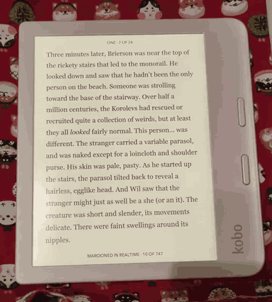

# Kobo Double Tap Highlight

Highlight words with a double tap in Kobo's built-in reader. Double-tap inside
an existing highlight to remove the entire highlight, including older highlights
and passages that contain several words.

Japanese text uses TinySegmenter to select words instead of individual
characters. Japanese long presses also select words by default, with an
optional NickelMenu toggle to restore Kobo's original long-press selection.
English uses Kobo's native word selection.

## English demo

Double-tap to add a highlight, then double-tap it again to remove it.
Click the animated preview to open the video.

[](docs/media/english-double-tap-demo.mp4)

## Compatibility

**Beta software. Only tested on Kobo Libra 2 with firmware 4.38.23852.**
Other models and firmware versions can try the plugin, but compatibility is
not confirmed. Back up your annotations and settings before installing.

- Works with **KEPUB books in the built-in Kobo reader**.
- EPUB and PDF support is not implemented.
- NickelMenu is optional and provides the Japanese long-press setting.
- No account, internet connection or PC connection is needed while reading.

## Installation

1. Back up your books, annotations and settings.
2. Download `KoboRoot.tgz` from [Releases](https://github.com/JuliBD/kobo-double-tap-highlight/releases).
   Checksums are provided in `SHA256SUMS.txt`.
3. Connect your Kobo to your computer by USB and open its drive.
4. Copy `KoboRoot.tgz`, **without extracting it**, into the hidden `.kobo`
   folder. If another update file is already there, finish that update first.
5. Safely eject the Kobo and let it install and restart.
6. Open a KEPUB book and try adding and removing a disposable highlight.

To update, repeat these steps with the newer release's `KoboRoot.tgz`.

## Highlighting

- **Add:** double-tap an unhighlighted word.
- **Remove:** double-tap anywhere inside a highlight. This removes the
  **entire highlight**, including a multiword passage.
- **Select Japanese words:** long-press Japanese text, then use Kobo's normal
  highlight, dictionary or selection-handle controls.

Single taps, page buttons and English long presses keep their usual behavior.
You can still highlight and remove highlights using Kobo's normal controls.

**Removal has no plugin undo command.** Handling of notes attached to removed
highlights has not been verified; do not assume an attached note will be
preserved.

## Japanese long-press setting

Japanese word selection for long presses is **On by default**. The plugin works
without NickelMenu; install the optional controls if you want to switch this
setting from a menu.

With NickelMenu already installed:

1. Download `NickelMenu-settings.zip` from the same release.
2. Extract it to the **Kobo drive root**, keeping its `.adds` folder structure.
3. Safely eject the Kobo.
4. Open NickelMenu from Home or the reader menu and choose
   **Japanese long-press words** to toggle the setting.

A message confirms **On** or **Off**. The change applies to your next long
press, persists across restarts and does not change double-tap word selection.
Existing NickelMenu entries are preserved.

Without NickelMenu, the setting can be changed in `.kobo/doubletap.conf`:

```ini
japanese_long_press_words=0
```

Use `0` for native long-press selection or `1` for Japanese word selection.
If the file is absent, word selection is enabled.

## Disable or uninstall

These files go in the **Kobo drive root**, alongside the `.kobo` folder.
Create an empty file with the exact name shown, **without a `.txt` extension**.
Safely eject, then fully power the Kobo off and on; sleep/wake is not enough.

| Action | File |
| --- | --- |
| Disable the plugin | Create `doubletap_disable` |
| Enable it again | Delete `doubletap_disable`, then restart |
| Uninstall | Create `doubletap_uninstall` |

Disabling affects both double taps and Japanese long-press expansion.
Uninstalling removes the plugin and its optional NickelMenu controls. Saved
highlights and notes remain; settings and diagnostic files are retained.
The uninstall flag removes itself. Reinstall using the normal installation
steps if you want the plugin back.

## Known limitations

- Japanese segmentation may split compounds or expressions into shorter pieces.
  It selects words rather than recognizing whole phrases.
- New highlights are limited by a 4096-entry tracking file. Removing existing
  highlights does not require a tracking entry.
- Other Kobo models, firmware versions and combinations of modifications need
  community testing. The plugin may stay inactive if required Kobo functions
  are unavailable.

## Report a problem

[Open an issue](https://github.com/JuliBD/kobo-double-tap-highlight/issues) with
your device model, firmware version, plugin version, book format and steps to
reproduce the problem. If an annotation looks wrong, mention whether it also
looks wrong in the annotations list and after reopening the book.

Inspect any logs or screenshots before sharing them. Do not upload whole books,
annotation databases or device backups.

[Build instructions](docs/build.md) · [Release notes](docs/release-notes.md) ·
[Third-party notices](THIRD_PARTY.md) · [MIT license](LICENSE)

An independent community project, unaffiliated with Kobo or Rakuten.
